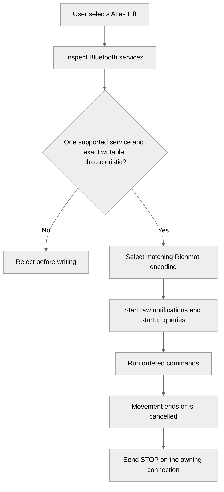

<!-- greptile_summary -->

<h2><ruby><rp>Confidence Score: 5/5 · The PR appears safe to merge within its stated ordinary Cama Lift scope.</rp></ruby><a href="https://app.greptile.com/api/retrigger?id=121140143&amp;sig=3ec545f57b8a1acf0fdec13ada80e4ceb9a8d654c4831ade6f3b84f484fbda89"><picture><source media="(prefers-color-scheme: dark)" srcset="https://greptile-static-assets.s3.amazonaws.com/badges/RetriggerDark.svg?v=2"><source media="(prefers-color-scheme: light)" srcset="https://greptile-static-assets.s3.amazonaws.com/badges/Retrigger.svg?v=2"></picture></a><a href="https://app.greptile.com/-/switch-tenant?tenant=kristofferr&amp;next=%2Fkristofferr%2Fha-adjustable-bed%2Fpull%2F1192&amp;utm_source=greptile_review&amp;utm_medium=github&amp;utm_campaign=view_in_greptile"><picture><source media="(prefers-color-scheme: dark)" srcset="https://greptile-static-assets.s3.amazonaws.com/badges/ViewInGreptileDark.svg?v=2"><source media="(prefers-color-scheme: light)" srcset="https://greptile-static-assets.s3.amazonaws.com/badges/ViewInGreptile.svg?v=2"></picture></a>Confidence Score: 5/5</h2>

**[Medium impact]** The PR appears safe to merge within its stated ordinary Cama Lift scope.

<h3>Summary</h3>

Adds Atlas Lift’s ordinary Cama Lift controls through the existing Richmat codec.
- Atlas Lift beds gain movement, preset, and massage controls.
- Atlas Lift appears as an app choice with a live service check.

`kristofferR` explicitly deferred F3: qualify the phone detector’s cooldown reset behavior and recheck its offline vectors. Manual Anti-snore recall is unaffected. Physical service assignment and bed response remain explicitly unverified.

<h3>Diagram</h3>

<!-- greptile_confidence_score:5 -->

Reviews (1) · Last reviewed commit: ["Add Atlas Lift BLE support"](https://github.com/kristofferr/ha-adjustable-bed/commit/042a8b2736b0e4015efd136f52795b4c05cdc843) · [Reviewed by Greptile](https://www.greptile.com/?utm_source=greptile_review&utm_medium=github&utm_campaign=review_public&utm_content=kristofferr/ha-adjustable-bed)