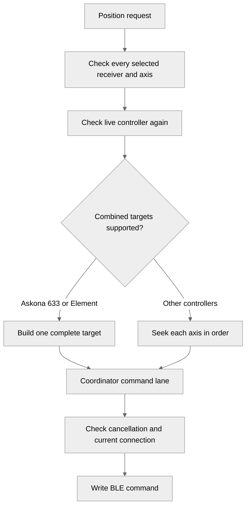

<!-- greptile_summary -->

<h2><ruby><rp>Confidence Score: 5/5 · The PR appears safe to merge within its stated feature and hardware limits.</rp></ruby><a href="https://app.greptile.com/api/retrigger?id=122172449&amp;sig=ca72b168405abe03380b1c60d8e7cb097a136875ff465c1976533d3edd94828f"><picture><source media="(prefers-color-scheme: dark)" srcset="https://greptile-static-assets.s3.amazonaws.com/badges/RetriggerDark.svg?v=2"><source media="(prefers-color-scheme: light)" srcset="https://greptile-static-assets.s3.amazonaws.com/badges/Retrigger.svg?v=2"></picture></a><a href="https://app.greptile.com/-/switch-tenant?tenant=kristofferr&amp;next=%2Fkristofferr%2Fha-adjustable-bed%2Fpull%2F1242&amp;utm_source=greptile_review&amp;utm_medium=github&amp;utm_campaign=view_in_greptile"><picture><source media="(prefers-color-scheme: dark)" srcset="https://greptile-static-assets.s3.amazonaws.com/badges/ViewInGreptileDark.svg?v=2"><source media="(prefers-color-scheme: light)" srcset="https://greptile-static-assets.s3.amazonaws.com/badges/ViewInGreptile.svg?v=2"></picture></a>Confidence Score: 5/5</h2>

**[Medium impact]** The PR appears safe to merge within its stated feature and hardware limits.

<h3>Summary</h3>

Adds explicit Askona 633, 180x200, and Element profiles over the existing Keeson codec.
- Askona beds use model-specific status and control rules.
- Askona setup lets each receiver keep its own model choice.
- Multi-axis position requests send one complete target when supported.

No actionable issues were found. Tests were inspected, not run.

Acknowledged boundaries from `kristofferR`: hardware remains unverified and source analysis remains partial. Nonzero 180x200 targets and directional/STOP controls are intentionally excluded because safe stopping is not established. Sensor, saved-position, alternate-session, and advanced-control work remains explicitly deferred.

<h3>Diagram</h3>

<!-- greptile_confidence_score:5 -->

Reviews (1) · Last reviewed commit: ["feat: add Askona bed profiles"](https://github.com/kristofferr/ha-adjustable-bed/commit/605a68e7ff137a4adc5b446074aede196d4db158) · [Reviewed by Greptile](https://www.greptile.com/?utm_source=greptile_review&utm_medium=github&utm_campaign=review_public&utm_content=kristofferr/ha-adjustable-bed)