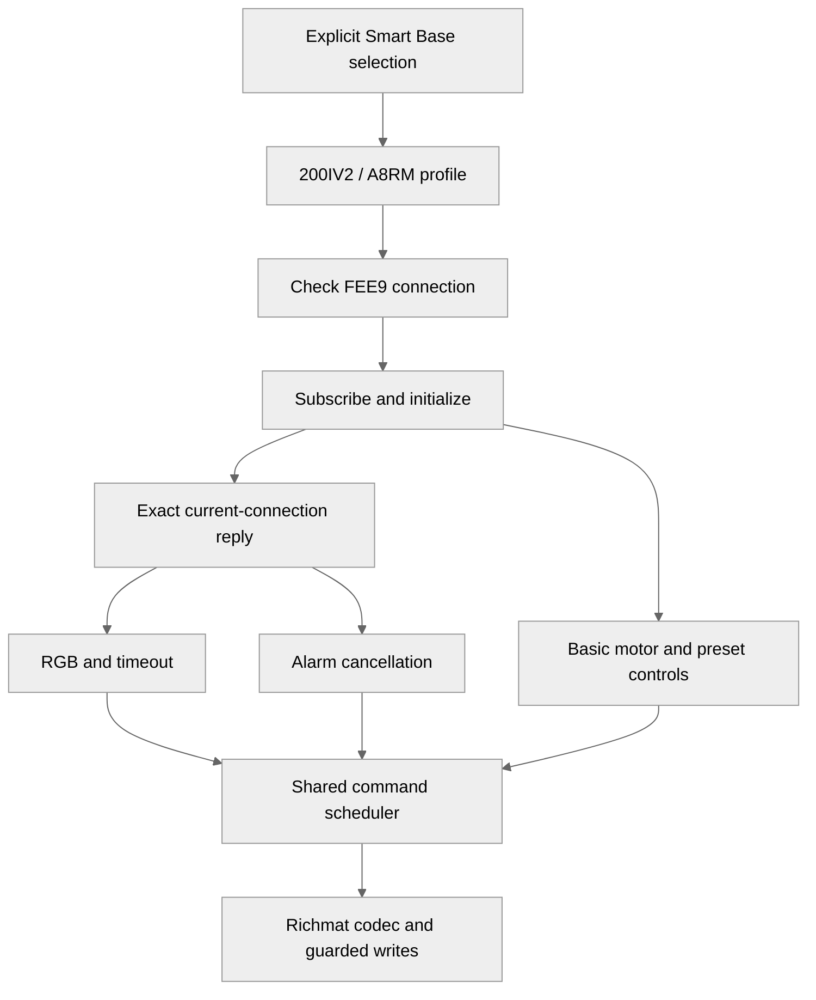

<!-- greptile_summary -->

<h2><ruby><rp>Confidence Score: 4/5 · Fix the light's power-on path and satisfy the two repository requirements before merging.</rp></ruby><a href="https://app.greptile.com/api/retrigger?id=122166699&amp;sig=e46ef6040305b1bd66f0a4de21af0f8deee2df00fbd67cfa1462c882d9d7b634"><picture><source media="(prefers-color-scheme: dark)" srcset="https://greptile-static-assets.s3.amazonaws.com/badges/RetriggerDark.svg?v=2"><source media="(prefers-color-scheme: light)" srcset="https://greptile-static-assets.s3.amazonaws.com/badges/Retrigger.svg?v=2"></picture></a><a href="https://app.greptile.com/-/switch-tenant?tenant=kristofferr&amp;next=%2Fkristofferr%2Fha-adjustable-bed%2Fpull%2F1241&amp;utm_source=greptile_review&amp;utm_medium=github&amp;utm_campaign=view_in_greptile"><picture><source media="(prefers-color-scheme: dark)" srcset="https://greptile-static-assets.s3.amazonaws.com/badges/ViewInGreptileDark.svg?v=2"><source media="(prefers-color-scheme: light)" srcset="https://greptile-static-assets.s3.amazonaws.com/badges/ViewInGreptile.svg?v=2"></picture></a>Confidence Score: 4/5</h2>

**[Medium impact]** The changes reach only beds explicitly set up with the Smart Base 200IV2 \/ A8RM profile\.

Fix the light's power-on path and satisfy the two repository requirements before merging.

<h2>Findings</h2>

1. &nbsp;**Light stays off after turn\-on** <a href="https://github.com/kristofferR/ha-adjustable-bed/pull/1241#discussion_r4723762672">▶</a>
2. &nbsp;**Refresh lacks required diagnostic flag** <a href="https://github.com/kristofferR/ha-adjustable-bed/pull/1241#discussion_r4723762674">▶</a>
3. &nbsp;**Detection repeats the profile name** <a href="https://github.com/kristofferR/ha-adjustable-bed/pull/1241#discussion_r4723762678">▶</a>

<h3>Summary</h3>

Adds the explicit Smart Base 200IV2 / A8RM route over the shared Richmat runtime.
- Smart Base setup offers the fixed 200IV2 / A8RM product.
- The 200IV2 panel moves two motors and saves its presets.
- LED and alarm replies unlock extra Smart Base settings.

<h3>Diagram</h3>

<!-- greptile_confidence_score:4 -->

Reviews (1) · Last reviewed commit: ["Merge main into Smart Base controls"](https://github.com/kristofferr/ha-adjustable-bed/commit/3ee8653629153f67c8d1a3abf8de7d7a1c914635) · [Reviewed by Greptile](https://www.greptile.com/?utm_source=greptile_review&utm_medium=github&utm_campaign=review_public&utm_content=kristofferr/ha-adjustable-bed)