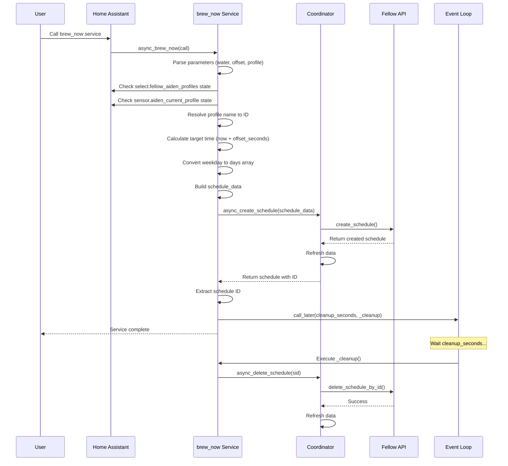

<h2>Greptile Overview</h2>

<h3>Greptile Summary</h3>

This PR adds a `brew_now` service that creates a one-time brew schedule by scheduling it for the near future and then auto-deleting it after a configurable delay.

## Key Changes
- **New Service**: Added `brew_now` service in `__init__.py` with intelligent profile resolution (checks service params, HA select entity, sensor entity, then falls back to "Light Roast")
- **Coordinator Enhancement**: Modified `async_create_schedule` and `async_create_profile` to return the created resource (needed to get schedule ID for cleanup)
- **Platform Declaration**: Added `"button"` to PLATFORMS list in `const.py`
- **Service Definition**: Added comprehensive service definition in `services.yaml` with configurable water amount, profile, start delay, and cleanup timing

## Critical Issues
- **Missing `button.py` file**: The PR adds `"button"` to PLATFORMS but doesn't include the `button.py` platform implementation, which will cause the integration to fail on load
- **Missing imports**: `timedelta` and `dt_util` are used but not imported in `__init__.py`, causing runtime errors when the service is called

## Design Notes
The cleanup mechanism uses `hass.loop.call_later()` to schedule deletion, which means schedules won't be cleaned up if Home Assistant restarts during the cleanup window. This is acceptable for a "quick brew" feature but could lead to schedule accumulation if users restart HA frequently.

<h3>Confidence Score: 1/5</h3>

- This PR will cause the integration to fail loading due to missing button platform file
- Two critical issues prevent this from working: (1) missing `button.py` platform file despite adding "button" to PLATFORMS will cause Home Assistant to fail loading the integration, and (2) missing required imports will cause runtime errors. The core logic appears sound but cannot be deployed as-is.
- Pay close attention to `custom_components/fellow/const.py` (missing button.py file) and `custom_components/fellow/__init__.py` (missing imports)

<h3>Important Files Changed</h3>

| Filename | Overview |
|----------|----------|
| custom_components/fellow/__init__.py | Added `brew_now` service with missing imports (`timedelta`, `dt_util`), potential race conditions in cleanup logic |
| custom_components/fellow/const.py | Added `button` to PLATFORMS but missing `button.py` file - will cause integration load failure |
| custom_components/fellow/coordinator.py | Modified `async_create_schedule` and `async_create_profile` to return results - clean implementation |
| custom_components/fellow/services.yaml | Added service definition for `brew_now` with appropriate parameters and documentation |

<h3>Sequence Diagram</h3>

