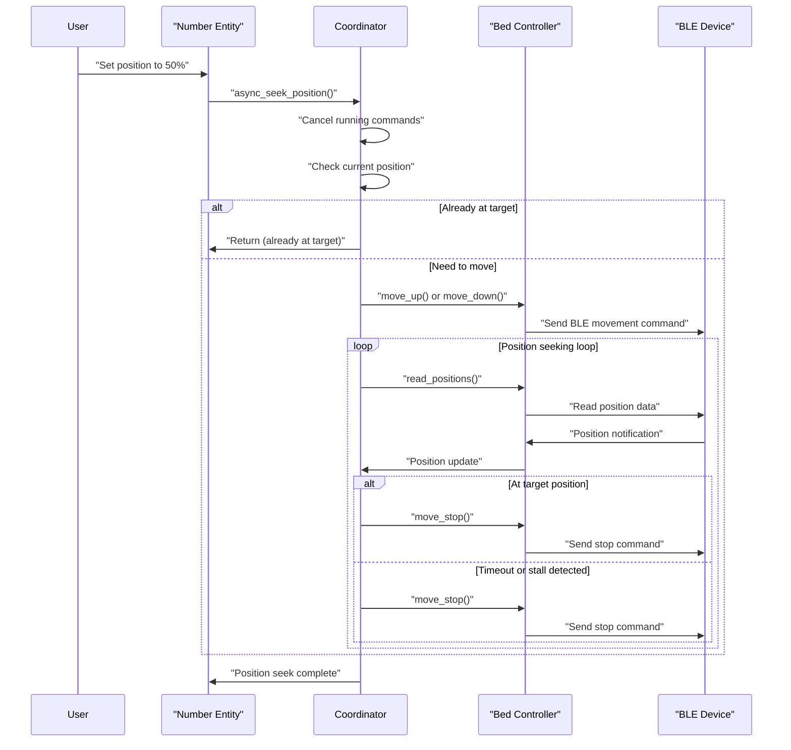

<h3>Greptile Summary</h3>

- Adds Number entities (position control sliders) for precise positioning of adjustable bed motors with 0-100% range on beds supporting position feedback
- Implements feedback-loop position seeking algorithm with timeout protection, stall detection, and overshoot handling since controllers only support directional movement
- Extends position feedback support to include Keeson and Ergomotion bed types beyond the existing angle-sensing beds

<h3>Important Files Changed</h3>

| Filename | Overview |
|----------|----------|
| custom_components/adjustable_bed/coordinator.py | Added `async_seek_position` method that bypasses documented command serialization pattern and has unsafe motor stop handling |
| custom_components/adjustable_bed/number.py | New platform implementing position control entities with proper delegation to coordinator and motor mapping logic |

<h3>Confidence score: 2/5</h3>

- This PR has serious architectural issues that could cause immediate problems with motor control safety
- Score lowered due to coordinator method bypassing established command locking pattern and unsafe error handling in motor stop logic
- Pay close attention to `custom_components/adjustable_bed/coordinator.py` for command serialization violations and motor stop safety issues

<h3>Sequence Diagram</h3>

